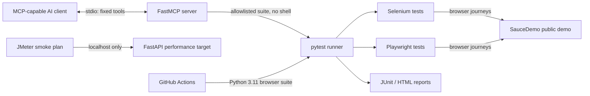

# TestForge | AI Quality Engineering Portfolio

[](https://github.com/notorious1337/testforge/actions/workflows/tests.yml)

**TestForge demonstrates how an AI assistant can safely discover and trigger deterministic QA workflows through MCP—without receiving arbitrary shell access.** The project combines browser automation, API checks, controlled test orchestration, and a local-only performance target.

> **Portfolio project, not a production test service.** Selenium and Playwright exercise the public SauceDemo demo storefront. JMeter is restricted to the FastAPI target running locally.

## Why this project

AI-assisted QE needs more than generated test code: it needs repeatable checks, actionable results, and clear boundaries on what automation is allowed to execute. TestForge connects an MCP-capable client to predefined pytest suites, while the tests themselves retain explicit locators, assertions, and normal pytest reporting.

The MCP server is **LLM-agnostic**. It does not include a model or ask an agent to invent browser actions; any compatible client can discover three fixed tools:

- `run_selenium_tests`
- `run_playwright_tests`
- `get_latest_results`

Each run tool maps to a hard-coded test directory and starts pytest with `subprocess.run` without `shell=True`. Tool arguments cannot provide commands, test paths, URLs, or credentials. Run summaries and JUnit files are saved under the ignored `artifacts/` directory.

## Architecture



The browser demo and performance target are intentionally separate: the JMeter plan must not send load to SauceDemo or any other public site.

## Test coverage

| Layer | Coverage | Execution |
| --- | --- | --- |
| Selenium | Valid login, invalid-login message, add backpack and verify cart | Browser suite |
| Playwright | Inventory, invalid login, cart and checkout summary | Browser suite |
| MCP | Exact allowlist, fixed pytest target, no shell, summary persistence, timeout reporting | Unit tests; stdio integration checked manually |
| FastAPI | `/health` status and `/products` payload/count consistency | API unit tests |
| JMeter | Two users × ten loops, `/health`, HTTP 200 assertion | Local smoke plan; not a capacity benchmark |
| CI | Browser tests and JUnit/HTML report artifacts | GitHub Actions on push/PR to `main` and manual dispatch |

## CI and verified results

The [GitHub Actions workflow](.github/workflows/tests.yml) installs Python 3.11 and Playwright Chromium, runs pytest, and uploads reports even when tests fail.

- **GitHub Actions, Python 3.11.17:** the expanded workflow passed all 11 browser, API, and MCP-guardrail tests in 14.96 seconds. [View run](https://github.com/notorious1337/testforge/actions/runs/39048938478).
- **Local Windows run, Python 3.13.14:** all 6 browser tests passed; JUnit XML and a self-contained HTML report were generated.
- **Expanded local suite:** all 11 browser, API, and MCP-guardrail tests passed; JUnit XML and a self-contained HTML report were regenerated.
- **MCP stdio integration:** a client discovered the three tools, ran the Playwright suite (3 passed), and retrieved the saved summary.
- **Local API:** `/health` and `/products` returned HTTP 200; the JMeter plan parsed as valid XML and targets only `127.0.0.1:8000` by default.

The API and MCP guardrail unit tests are included in the current suite. JMeter execution and measured performance results are **not** claimed: Java was not functional and JMeter was unavailable in the local environment. The MCP Inspector web UI was also not independently validated.

## Quick start (Windows PowerShell)

Run from the repository root. Python 3.11 is used by CI:

```powershell
py -3.11 -m venv .venv
.\.venv\Scripts\Activate.ps1
python -m pip install --upgrade pip
python -m pip install -r requirements.txt
python -m playwright install chromium
```

If PowerShell blocks activation, run `Set-ExecutionPolicy -Scope Process -ExecutionPolicy Bypass` in the current terminal, then activate again. Selenium Manager locates/manages ChromeDriver. Set `CHROME_BINARY` if Chrome is not discoverable:

```powershell
$env:CHROME_BINARY = "C:\path\to\chrome.exe"
```

SauceDemo settings can be overridden with `SAUCEDEMO_URL`, `SAUCEDEMO_USERNAME`, and `SAUCEDEMO_PASSWORD`. Selenium runs headless by default; set `$env:HEADLESS = "false"` to show its browser.

## Run tests and create reports

Run each browser framework separately:

```powershell
python -m pytest tests\selenium -v -m selenium
python -m pytest tests\playwright -v -m playwright
```

Run all tests, including MCP-guardrail and API unit tests:

```powershell
python -m pytest tests -v
```

Generate CI-style JUnit and HTML reports:

```powershell
New-Item -ItemType Directory -Force artifacts | Out-Null
python -m pytest tests -v `
  --junitxml=artifacts\junit.xml `
  --html=artifacts\pytest-report.html `
  --self-contained-html
```

Reports and other generated results under `artifacts/` are ignored by Git; only `.gitkeep` is tracked.

## Run the local performance target

Start FastAPI in one terminal:

```powershell
python -m uvicorn app.performance_target:app --host 127.0.0.1 --port 8000
```

Check the endpoints from another terminal:

```powershell
Invoke-RestMethod http://127.0.0.1:8000/health
Invoke-RestMethod http://127.0.0.1:8000/products
```

With a JDK and Apache JMeter 5.6.3 on `PATH`, run the local health smoke plan:

```powershell
New-Item -ItemType Directory -Force artifacts | Out-Null
jmeter -n -t performance\health_smoke.jmx `
  -l artifacts\jmeter-results.jtl `
  -e -o artifacts\jmeter-dashboard
```

The default plan uses two virtual users and ten loops each against `http://127.0.0.1:8000/health`. Use `-Jhost`/`-Jport` only for another authorized local target. JMeter requires a new or empty dashboard directory. This smoke test is not a capacity benchmark; publish only measurements from an actual run and include the workload and test environment.

## Connect an MCP client

The server communicates over stdio:

```powershell
python -m mcp_server.server
```

An MCP client should launch that command as a child process. To inspect the tools with MCP Inspector:

```powershell
npx -y @modelcontextprotocol/inspector .\.venv\Scripts\python.exe -m mcp_server.server
```

Manual pytest runs do not update MCP summaries; only MCP-triggered runs do.

## Limitations and responsible use

- SauceDemo is a public demonstration storefront, not a service controlled by this project. Browser tests depend on network availability and upstream UI stability.
- JMeter targets only the local FastAPI app by default. Never load test SauceDemo or another public site.
- The JMeter plan is a small smoke workload, not a benchmark or capacity claim.
- Results depend on the runtime, browser, machine, network, and test workload.
- The MCP interface exposes a fixed set of test operations; it is not a general-purpose command runner.
- This project demonstrates a portfolio workflow, not a production-ready test orchestration service.
